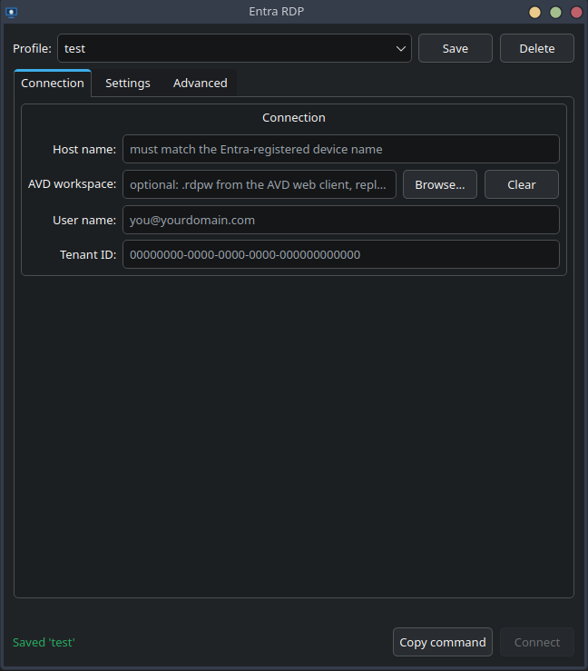
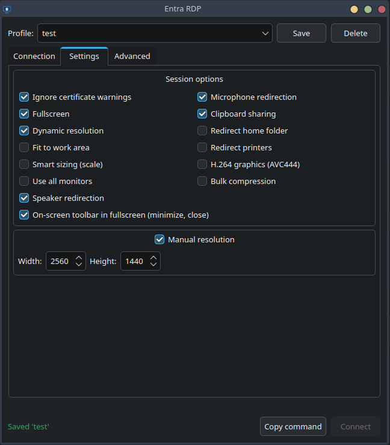
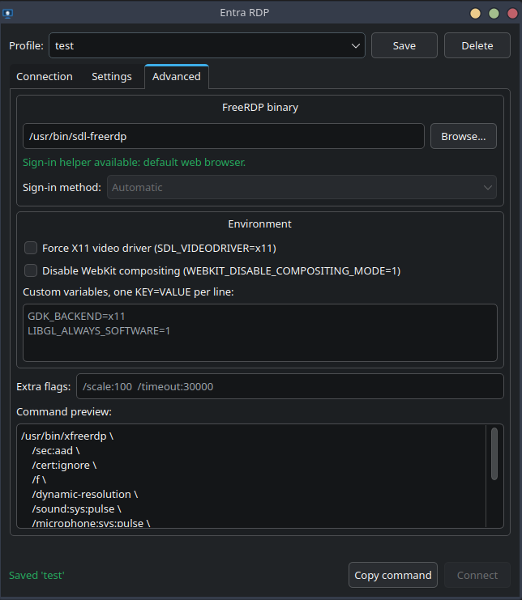

# Entra RDP

A desktop app for connecting to **Microsoft Entra ID (Azure AD) joined Windows machines** from Linux, with web account sign-in. It's the Linux equivalent of the *"Use a web account to sign in to the remote computer"* checkbox in Windows' `mstsc.exe`.

It's a front end for [FreeRDP](https://github.com/FreeRDP/FreeRDP). You fill in a host, user and tenant, choose your options, and press Connect. The app builds the FreeRDP command line and runs it.

**Azure Virtual Desktop** works too, through a workspace file downloaded from the AVD web client. See [Azure Virtual Desktop](#azure-virtual-desktop).



- **Profiles** for each machine and tenant, saved without any credentials
- **Sign-in through your default browser** or an embedded window, whichever your FreeRDP offers
- **Session options as checkboxes:** fullscreen, resolution, audio, microphone, clipboard, drives, printers
- **An on-screen toolbar** for fullscreen sessions, so a single monitor still has minimize and close buttons
- **A check of your FreeRDP before you connect:** whether it can sign in, and whether it still starts after an OS upgrade
- **A live command preview**, so nothing is hidden. Copy it and run it in a terminal whenever you want to

---

## Requirements

- **Python 3 with PyQt6.** The installer adds it if missing.
- **FreeRDP 3.32 or newer, packaged with a sign-in helper.** On a current distribution, that's simply its `freerdp` package.

FreeRDP 3.32 moved Entra sign-in into small helper programs. The browser-based one needs no extra dependencies, so distributions can ship it, and **Fedora 45 does.** To check your own FreeRDP:

```console
$ sdl-freerdp /buildconfig | tr ' ' '\n' | grep -E 'WITH_AAD|AUTH_HELPER'
WITH_AAD=ON
WITH_QT_AAD_AUTH_HELPER=OFF
WITH_WEBVIEW_AAD_AUTH_HELPER=OFF
WITH_XDG_AAD_AUTH_HELPER=ON
```

At least one `…_AUTH_HELPER=ON` means it will work. If none is on, sign-in falls back to copy and paste: FreeRDP prints a login URL, you sign in in a browser, then paste the redirect URL back into the terminal. In that case the installer can build a FreeRDP that signs in properly; see [Building FreeRDP yourself](#building-freerdp-yourself).

| Platform | Status |
|---|---|
| **Fedora 45** | Tested. The distribution's FreeRDP signs in through the default browser. Nothing is compiled |
| **Fedora 43 / 44** | The browser helper is coming as an update (3.33.1). Until it reaches the stable repositories, the installer takes `freerdp` alone from updates-testing. Fedora 44 was also tested with a FreeRDP built by this project's scripts |
| Other Fedora / RHEL | Should work. Uses the distribution package if it has a sign-in helper, otherwise builds from source |
| Debian / Ubuntu / Arch | **Untested.** Works if the distribution's FreeRDP is 3.32+ with a helper. Otherwise the source build is used, and its dependency lists have only been tried on Fedora |
| Anything else | The app runs anywhere PyQt6 does. Supply a FreeRDP yourself and install with `SKIP_FREERDP=1` |

## Install

```bash
git clone https://github.com/themew2/FreeRDP-to-Entra-Connected-Windows-Device.git
cd FreeRDP-to-Entra-Connected-Windows-Device
./scripts/install.sh
```

The installer:

1. installs PyQt6 if needed
2. checks every installed FreeRDP client for sign-in support
3. if none can sign in, installs or updates your distribution's FreeRDP and checks again. On Fedora it then tries `freerdp` from updates-testing, where Fedora 43 and 44 have the sign-in helper until it reaches stable
4. **compiles FreeRDP only if none of that gives one that can sign in**
5. installs the app and its menu entry

On Fedora 45 this takes seconds. Only package installation needs `sudo`.

Launch **Entra RDP** from your application menu, or run `entrardp`.

| Variable | Effect |
|---|---|
| `SKIP_FREERDP=1` | Don't install or build FreeRDP. Point the app at your own binary on its *Advanced* tab |
| `FORCE_FREERDP_BUILD=1` | Build FreeRDP even though an installed one can sign in. Use this to get the embedded sign-in window when your distribution only ships the browser helper |

The app is copied to `~/.local/share/entrardp/app` and started by a small launcher at `~/.local/bin/entrardp`, which uses whichever `python3` is current. An OS upgrade that changes the Python version doesn't break it. To update, `git pull` and run `install.sh` again.

### Uninstalling

```bash
rm -rf ~/.local/share/entrardp/app ~/.local/bin/entrardp
rm -f ~/.local/share/applications/io.github.themew2.EntraRDP.desktop
rm -rf ~/.config/entrardp ~/.cache/entrardp
```

If this project built a FreeRDP for you, remove that too:

```bash
rm -rf ~/.local/share/entrardp
sudo dnf remove freerdp-nightly        # only if an older version built the RPM
```

---

## Usage

The window has a profile selector at the top and three tabs below it:

| Tab | Contents |
|---|---|
| **Connection** | Host name, AVD workspace, user name, tenant ID |
| **Settings** | Session options, on-screen toolbar, manual resolution |
| **Advanced** | FreeRDP binary and sign-in method, environment variables, extra flags, command preview |

Warnings, status, **Copy command** and **Connect** stay visible below the tabs.

| Settings | Advanced |
|---|---|
|  |  |

### Connecting

Fill in the *Connection* tab and press **Connect**:

| Field | Notes |
|---|---|
| **Host name** | Must match the Entra-registered device name **exactly**, and must resolve through DNS or `/etc/hosts`. |
| **AVD workspace** | Optional. A `.rdpw` file from the Azure Virtual Desktop web client, used instead of the host name. See below. |
| **User name** | `you@yourdomain.com` |
| **Tenant ID** | Your Entra tenant GUID, from Azure Portal → Microsoft Entra ID → Overview. |

You need either a host name or a workspace file. Setting both is reported as a conflict.

When you connect, FreeRDP opens the Microsoft sign-in page. With the default browser helper this appears in your normal browser. If the browser is already signed in to your Microsoft account, you may not be asked for a password or MFA again. When sign-in finishes, the session opens.

### Profiles

Type a name in the *Profile* box and press **Save** to keep the current settings. The app reopens on whichever profile you last saved or loaded. Profiles are stored in `~/.config/entrardp/profiles.json` and the last-used name in `~/.config/entrardp/state.json`, both with mode `600`.

**No credentials are ever stored.** Authentication happens entirely in FreeRDP's sign-in window or your browser. The app keeps only host names, user names, tenant IDs, your settings, and the path to a workspace file.

### Sign-in method

The *FreeRDP binary* section of the *Advanced* tab shows the selected binary and reports how it signs in:

| Report | Meaning |
|---|---|
| **Sign-in helper available** (green) | FreeRDP 3.32+ with at least one helper installed beside it |
| **Embedded sign-in window** (green) | FreeRDP 3.16–3.31 built with the older `WITH_WEBVIEW` option |
| **No sign-in window** (orange) | Sign-in will print a URL to copy into a browser and back. Also says when a helper was configured but its program is missing |
| **This build cannot start** (red) | Libraries it was linked against are gone, almost always after an OS upgrade. Connect is disabled, and the app switches to a working binary if it finds one |

When the report is orange or red, the *Advanced* tab shows a warning icon, so you can see it from the other tabs.

If the binary has more than one helper, *Sign-in method* chooses between them:

| Choice | What happens |
|---|---|
| **Automatic** | FreeRDP picks, in its own order: default browser, then Qt, then WebKitGTK |
| **Default web browser** | Opens the sign-in page in your browser, which may already be signed in to your Microsoft account |
| **Embedded window (WebKitGTK / Qt WebEngine)** | A dedicated sign-in window |

The choice appears as `/azure:…,auth-helper:<path>` in the command preview. Profiles save it by name rather than path, so a profile still works after moving to another machine or FreeRDP install. If a profile asks for a helper the current binary doesn't have, the app uses Automatic and keeps the profile's preference.

### On-screen toolbar

A fullscreen session covers the whole screen, which on a single monitor leaves no visible way out. Tick **On-screen toolbar in fullscreen** on the *Settings* tab to get a small bar at the top of the screen with minimize, restore and close buttons.

FreeRDP's SDL client, which the app normally runs, has no such toolbar. So with the box ticked, the app runs **`xfreerdp`, FreeRDP's X11 client, from the same install** instead, and adds:

```
/floatbar:sticky:off,default:visible,show:fullscreen
```

The bar starts visible, slides away, and comes back when the mouse touches the top edge of the screen. It appears only in fullscreen. Sign-in works the same way, since both clients use the same helpers, and every session option applies to both. The checkbox is greyed out when there's no `xfreerdp` (or `xfreerdp3`) beside the selected binary. Fedora's `freerdp` package includes one.

The toolbar text uses an old X11 font and looks rough. That's FreeRDP's toolbar drawing, not something this app controls.

### Azure Virtual Desktop

AVD doesn't give you a host name. The web client at [client.wvd.microsoft.com](https://client.wvd.microsoft.com/arm/webclient/) gives you a **workspace file** instead: a `.rdpw` file containing the session host, the gateway address, and a load-balancing token.

Download one, then select it with **Browse…** next to *AVD workspace*. FreeRDP reads `.rdpw` files itself, so the app passes the file through without reading or changing it.

Selecting a file changes three things:

- The **host name** field greys out and is ignored. It isn't cleared, so pressing **Clear** brings back your previous setup.
- `/v:` is left out of the command, and the file is passed along with `/gateway:type:arm`. Without that flag, the client tries to reach the session host directly and fails.
- The DNS check is skipped, since there's no host name to look up.

**Workspace files expire.** The certificate inside one is valid for a few months after download, and the only fix is downloading a new file from the web client. The app warns once a file is more than 90 days old, judging by its modification time. That's only an estimate, so it warns rather than blocks. If a connection fails with `0x1608` after the warning, the file has almost certainly expired.

> **Untested against a live AVD deployment.** The command line follows FreeRDP's documented handling of `.rdpw` files, but nobody has confirmed it end to end yet. Reports either way are welcome.

### Session options

On the *Settings* tab, each checkbox maps to one FreeRDP flag. The flag is shown in the checkbox's tooltip, and the command preview updates as you change them.

The defaults are a known-working setup: fullscreen, fixed resolution, certificate warnings ignored, audio in and out, and clipboard sharing.

### Environment

On the *Advanced* tab, two checkboxes and a free-text list set the environment variables at the front of the command preview:

| Control | Effect |
|---|---|
| **Force X11 video driver** | `SDL_VIDEODRIVER=x11`. On by default, because an embedded sign-in window doesn't appear reliably on native Wayland. **Untick it when you use browser sign-in**: it isn't needed there, and it keeps FreeRDP's own dialogs on top of your browser. |
| **Disable WebKit compositing** | `WEBKIT_DISABLE_COMPOSITING_MODE=1`. Off by default. Turn it on if an embedded WebKitGTK sign-in window crashes. |
| **Custom variables** | One `KEY=VALUE` per line. Values may contain spaces, and surrounding quotes are dropped, so a line copied from a shell snippet works as written. `#` starts a comment. |

Custom variables are applied last, so setting `SDL_VIDEODRIVER` or `WEBKIT_DISABLE_COMPOSITING_MODE` there overrides the checkbox, and the app warns you when that happens. A line that isn't a valid assignment is reported and skipped. All three are saved with the profile.

*Extra flags* adds any other FreeRDP options to the end of the command.

### Keyboard shortcuts inside a session

The two clients use different shortcuts:

| Action | SDL client (default) | X11 client (on-screen toolbar) |
|---|---|---|
| Toggle fullscreen | `Right Shift` + `Enter` | `Ctrl` + `Alt` + `Enter` |
| Minimize | `Right Shift` + `M` | toolbar button |

---

## Troubleshooting

### Connecting and signing in

**FreeRDP's dialogs stay on top of the browser during sign-in.**
Untick *Force X11 video driver* on the *Advanced* tab. You only need it for an embedded sign-in window.

**Sign-in prints a URL instead of opening a browser or window.**
The binary has no usable sign-in helper. The *Advanced* tab says so in orange, and names any helper that was configured but whose program is missing. Install your distribution's FreeRDP if it's 3.32 or newer, or run `./scripts/install.sh`, which builds one if nothing installed can sign in.

**The browser opens for sign-in, but the session never continues.**
The browser helper gets the result back through an `ms-appx-web://` link handler that FreeRDP registers in `~/.local/share/applications` the first time it runs. If your browser asks whether to open the link, allow it. If nothing happens, check that `xdg-open` and `xdg-mime` are installed (`xdg-utils`), or choose an embedded window under *Sign-in method* if your binary has one.

**`Cannot find KDC for realm`.**
`/sec:aad` is missing. The app always adds it, so this points at something in *Extra flags* overriding it.

**Command line parsing failed at 'azure'.**
A quote character got pasted into a field. The app removes these automatically. If you still see this, check *Extra flags*.

**Host does not resolve.**
The app warns before connecting. Entra-joined machines often aren't in corporate DNS, so add an `/etc/hosts` entry. This check is skipped when you connect through an AVD workspace file.

**AVD connection fails with `0x1608`, or stops working after months of use.**
The certificate inside the workspace file has expired. Download a new `.rdpw` from the [AVD web client](https://client.wvd.microsoft.com/arm/webclient/) and select it again. The app's 90-day warning is only an estimate, so a younger file can still be expired.

**AVD connects to nothing, or times out reaching the session host.**
An AVD session host is only reachable through the ARM gateway. The app always adds `/gateway:type:arm` when a workspace file is set. Check *Extra flags* for a conflicting `/gateway:` entry, and confirm the command preview still includes it.

**The embedded sign-in window never appears on Wayland.**
Leave *Force X11 video driver* ticked. An embedded sign-in window doesn't appear reliably on native Wayland.

**The embedded sign-in window crashes, or appears and vanishes.**
For the WebKitGTK window, tick *Disable WebKit compositing*. For the Qt WebEngine window, add `QTWEBENGINE_CHROMIUM_FLAGS=--disable-gpu` under custom variables. Or choose *Default web browser* under *Sign-in method*.

### After an OS upgrade

**`entrardp` fails with `No module named 'entrardp'`.**
You have an install from an older `install.sh`, which tied the app to one Python version. Fedora 44 → 45 moved from Python 3.14 to 3.15 and left it behind. Run `./scripts/install.sh` again. Current versions don't depend on the Python version, and the installer removes the old copy.

**The app reports "This build cannot start".**
A FreeRDP you compiled yourself is linked against the libraries that were current when you built it. An upgrade replaces some of them (Fedora 45 moved OpenSSL, FFmpeg and ICU to new versions), and the build no longer starts. The app disables Connect and switches to a working binary if there is one. Run `./scripts/install.sh` again: it uses your distribution's FreeRDP if that can sign in, and rebuilds otherwise. Once you no longer need the old build, remove it with `rm -rf ~/.local/share/entrardp/freerdp`, or `sudo dnf remove freerdp-nightly` if an older version of the installer built it as an RPM. The app no longer looks in `/opt/freerdp-nightly`.

### The app itself

**The application shows a generic icon.**
Run `./scripts/diagnose-icon.sh`, which checks each step of the icon lookup.

The most common cause is a stale `icon-theme.cache`, which lookups trust over the directory contents:

```bash
rm -f ~/.local/share/icons/hicolor/icon-theme.cache
gtk-update-icon-cache -f -t ~/.local/share/icons/hicolor
kbuildsycoca6 --noincremental
```

If the menu entry is still generic, restart the shell with `systemctl --user restart plasma-plasmashell`.

The other common cause is a missing `~/.local/share/icons/hicolor/index.theme`, without which lookups skip the directory. `install.sh` creates it. To fix an existing installation:

```bash
cp /usr/share/icons/hicolor/index.theme ~/.local/share/icons/hicolor/
kbuildsycoca6 --noincremental
```

On Wayland there's no per-window icon. The compositor matches the window to its desktop entry and uses that entry's icon.

---

## Building FreeRDP yourself

You only need this if your distribution's FreeRDP can't sign in, or if you want the embedded sign-in window and your distribution only ships the browser helper. `install.sh` does it for you automatically in the first case, and with `FORCE_FREERDP_BUILD=1` in the second.

The build script builds the newest FreeRDP release with **both** sign-in helpers, default browser and embedded window, so the app can offer either. A build takes 20–40 minutes.

```
install.sh
  ├─ python3-pyqt6                installed if missing
  ├─ python3 -m entrardp.freerdp  can an installed FreeRDP sign in?
  │    yes → done
  │    no  → install or update the distribution's FreeRDP, then ask again
  │            yes → done
  │            no  → Fedora: freerdp from updates-testing, then ask again
  │                    yes → done
  │                    no  → build-freerdp.sh
  ├─ the app, to ~/.local/share/entrardp/app, launcher ~/.local/bin/entrardp
  └─ desktop entry, icons, AppStream metainfo
```

To see what the app's FreeRDP check finds, without installing anything:

```bash
PYTHONPATH=src python3 -m entrardp.freerdp                       # every installed client
PYTHONPATH=src python3 -m entrardp.freerdp /path/to/sdl-freerdp  # one binary
```

The build script chooses the build options from the FreeRDP source itself. A 3.32+ source gets the two sign-in helpers. Older source (3.16–3.31) gets `WITH_WEBVIEW`, the embedded window those versions used. This matters because CMake silently ignores `-DWITH_WEBVIEW=ON` on 3.32+ and builds a client with no sign-in window at all.

### `scripts/build-freerdp.sh`

Compiles FreeRDP into `~/.local/share/entrardp/freerdp`, a private location that doesn't clash with your distribution's package.

Earlier versions built an RPM from upstream's `freerdp-nightly.spec` on dnf systems. That route has been removed. If you still have it, `sudo dnf remove freerdp-nightly` takes it away.

| Step | What happens |
|---|---|
| Dependencies | Detects `dnf`, `apt` or `pacman`, and installs compilers and libraries |
| Preflight | Checks every requirement with `pkg-config` and lists *all* missing ones at once |
| Version | Looks up the newest `3.x.y` release, and refuses anything older than 3.16.0 |
| Configure | Starts from scratch each time, with the sign-in options for this source, Entra and PulseAudio support, and `WITH_SSO_MIB` if available |
| Check | Stops unless each sign-in helper was actually set up to be built |
| Build and install | `cmake --build`, then `--target install` |
| Verify | Confirms the helpers were installed next to the client |

The check exists because CMake accepts options it doesn't recognise without complaint. Without the check, a build can succeed, install, and run while silently lacking sign-in. Configuring from scratch matters after an OS upgrade, the usual reason to rebuild, because a leftover configuration refers to library versions that no longer exist.

| Variable | Default | Purpose |
|---|---|---|
| `SKIP_DEPS=1` | off | Don't install packages. Preflight still runs |
| `SKIP_PREFLIGHT=1` | off | Continue despite preflight warnings, when a library is installed under an unexpected `pkg-config` name |
| `FREERDP_BRANCH` | newest release tag | Branch or tag to build |
| `ENTRARDP_PREFIX` | `~/.local/share/entrardp/freerdp` | Install somewhere else |
| `JOBS` | all cores | Limit parallel compilation |
| `WITH_SSO_MIB` | `auto` | Automatic sign-in through a local identity broker, such as Microsoft's Intune client |

### Keeping a self-built FreeRDP updated

Your distribution's FreeRDP gets security updates with the rest of the system. **A FreeRDP you built doesn't.** It can also stop starting after an OS upgrade, which the app will report. An RDP client signs in and handles untrusted network data, so don't install it and forget it.

FreeRDP releases often, and some releases carry important security fixes. Check what you're running:

```bash
~/.local/share/entrardp/freerdp/bin/sdl-freerdp /version
```

Compare that against FreeRDP's [releases](https://github.com/FreeRDP/FreeRDP/releases) and [security advisories](https://github.com/FreeRDP/FreeRDP/security/advisories), and rebuild when a security release comes out. Re-running the build script picks up the newest release. To build a specific version, or unreleased changes:

```bash
FREERDP_BRANCH=<release-tag> ./scripts/build-freerdp.sh
FREERDP_BRANCH=master ./scripts/build-freerdp.sh
```

If your distribution's FreeRDP gains a sign-in helper later, switch to it and remove your own build.

### Build troubleshooting

**dnf reports an ffmpeg conflict (`libavcodec-free` vs `ffmpeg-libs`).**
Your system has RPM Fusion's full ffmpeg, which conflicts with Fedora's reduced `libav*-free` packages. Current scripts ask for whichever you already have. If you still hit this, install `ffmpeg-devel` and re-run with `SKIP_DEPS=1`. **Don't use `--allowerasing`**: it would replace RPM Fusion's ffmpeg system-wide.

**`Could NOT find Wayland (missing: XKBCOMMON_INCLUDE_DIR)`.**
Install `libxkbcommon-devel` (Fedora), `libxkbcommon-dev` (Debian/Ubuntu), or `libxkbcommon` (Arch). This is a different package from `libxkbfile`.

**cmake warns that `jansson` and `json-c` were not found.**
FreeRDP needs a JSON library for Entra sign-in. Install `jansson-devel` (Fedora), `libjansson-dev` (Debian/Ubuntu), or `jansson` (Arch).

**`The following required packages were not found: sso-mib>=0.5.0`.**
You set `WITH_SSO_MIB=ON` without the library installed. The default, `auto`, builds without it when it's missing. It has nothing to do with the sign-in window.

**Preflight reports a library as missing that you know is installed.**
`pkg-config` names differ between distributions. Find the real name with `pkg-config --list-all | grep -i <library>`, then re-run with `SKIP_PREFLIGHT=1`, or open an issue so the name can be added.

**Scratchy microphone audio in Teams, but fine locally.**
Check whether your build has debug settings turned on:

```bash
<path-to-binary> /buildconfig | tr ' ' '\n' | grep -iE 'VERBOSE_WINPR|VAAPI_H264'
```

If `WITH_VERBOSE_WINPR_ASSERT=ON`, it's probably the old `freerdp-nightly` RPM, which left it on. Remove it with `sudo dnf remove freerdp-nightly` and use your distribution's FreeRDP or `./scripts/build-freerdp.sh` instead.

---

## Development

```
src/entrardp/
    config.py     Session options, input cleaning, profile storage
    freerdp.py    Finding FreeRDP binaries, checking their sign-in support,
                  building the command line; also runnable as
                  `python3 -m entrardp.freerdp`
    gui.py        PyQt6 interface
scripts/
    install.sh            Entry point: installs FreeRDP if needed, the app,
                          and the menu entry
    build-freerdp.sh      Compiles into a private location
    freerdp-common.sh     Shared by the scripts above
    diagnose-icon.sh      Reports why the application icon may not appear
tests/                 Command line, sign-in detection, input cleaning,
                       profile storage
data/                  Desktop entry, AppStream metainfo, icons
```

To run the app straight from a checkout, without installing:

```bash
PYTHONPATH=src python3 -m entrardp
```

The tests need neither a display nor FreeRDP:

```bash
pip install . pytest ruff
pytest tests/
ruff check src/ tests/
shellcheck scripts/*.sh docs/*.sh
```

CI runs these on every pull request, plus `desktop-file-validate` and `appstreamcli` on the desktop metadata.

## History

This project began as a build guide. Until FreeRDP 3.32, distributions shipped FreeRDP without any Entra sign-in window, because the in-process webview of 3.16–3.31 downloaded a library while building, which packaging rules forbid. The only way to get a sign-in window was to compile FreeRDP yourself, and this repository's scripts and app grew out of doing that on Fedora and Nobara.

FreeRDP's maintainers then moved sign-in out of the client into separate helper programs ([FreeRDP#13237](https://github.com/FreeRDP/FreeRDP/issues/13237)). That landed in **3.32.0**, and distributions can now ship working Entra sign-in. After a request from this project ([rhbz#2520877](https://bugzilla.redhat.com/show_bug.cgi?id=2520877)), Fedora enabled the browser sign-in helper in its `freerdp` package: in Fedora 45, and as an update for Fedora 43 and 44. The embedded sign-in window is still not packaged, because it depends on a library fork that upstream hasn't merged. Building is now a fallback, and the app is the main part of this project.

The original walkthrough, for FreeRDP 3.16–3.31, is kept at [docs/BUILD-GUIDE.md](docs/BUILD-GUIDE.md) along with the original `rdp-aad.sh` wrapper script.

## Credits

Built on [FreeRDP](https://github.com/FreeRDP/FreeRDP). Thanks to [@akallabeth](https://github.com/akallabeth) on the FreeRDP team for reviewing the original guide and fixing bugs it turned up; see [FreeRDP#13201](https://github.com/FreeRDP/FreeRDP/issues/13201).

## License

[The Unlicense](LICENSE): public domain, no conditions. FreeRDP itself, which this app runs but doesn't include, is Apache-2.0.
